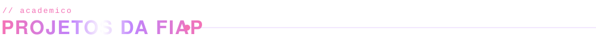
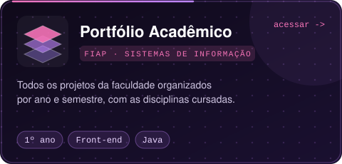
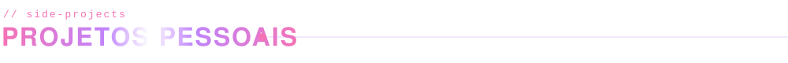
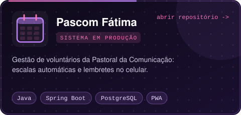
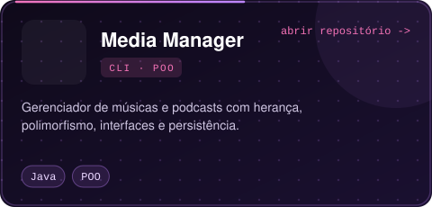
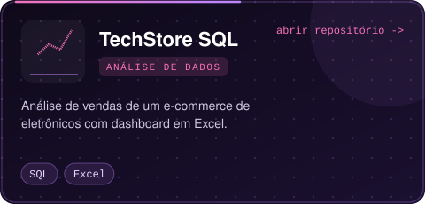
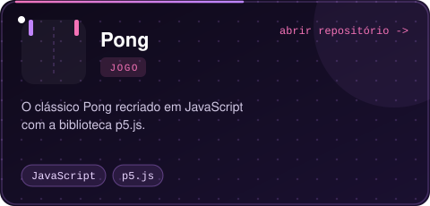
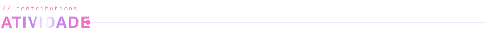

  

  
  

Estudante de **Sistemas de Informação na FIAP**, com foco em **desenvolvimento backend com Java**.
Gosto de transformar problemas reais em sistemas simples de usar.

  

  

  
  

  
  

  <picture>
    <source media="(prefers-color-scheme: dark)" srcset="https://raw.githubusercontent.com/AnaBia-Kurihara/AnaBia-Kurihara/output/snake-dark.svg" />
    <source media="(prefers-color-scheme: light)" srcset="https://raw.githubusercontent.com/AnaBia-Kurihara/AnaBia-Kurihara/output/snake-light.svg" />
    
  </picture>

